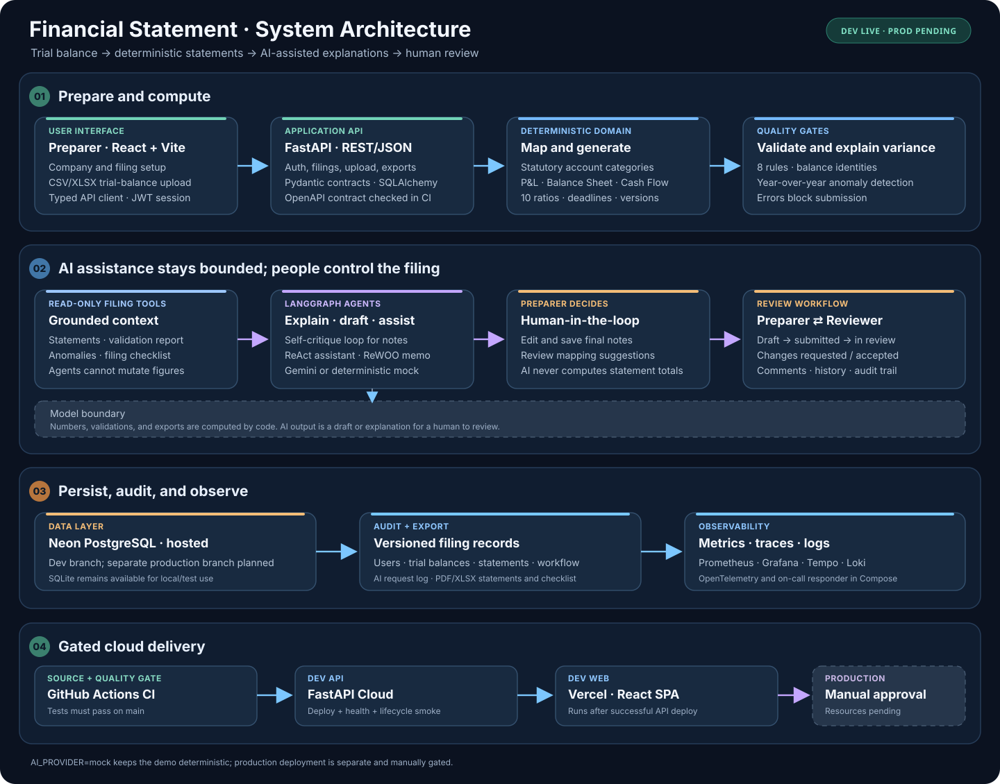

# Financial Statement (صورت مالی) — AI-Assisted Financial Statements & Tax Filing Platform

**Financial Statement** helps accountants and small companies turn a raw
trial balance into statutory financial statements, validate them against filing rules, get
AI-drafted explanations and notes, and run a proper **submit → review → accept** workflow with a
full audit trail — instead of juggling spreadsheets and email.

> Built for the [DataTalksClub AI Dev Tools Zoomcamp 2026](https://github.com/DataTalksClub/ai-dev-tools-zoomcamp) final project.
> English UI, Iranian statutory context (اظهارنامه مالیاتی / صورت‌های مالی).


> 🎥 **Video Demo:** [Watch the Financial Statement screencast](docs/videos/Screencast%20from%2010-27-2026%2003%3A46%3A33%20AM.webm)

---

## The problem

Every Iranian company must prepare annual financial statements — profit & loss
(صورت سود و زیان), balance sheet (صورت وضعیت مالی), and explanatory notes — and file its tax
declaration with the Iranian National Tax Administration within **4 months of fiscal year-end**
(Art. 95 of the Direct Taxes Act; statutory formats published by the INTA).

In practice this happens in spreadsheets:

- mapping a trial balance to the statutory layout is manual and error-prone;
- balance checks (debits = credits, assets = liabilities + equity) are eyeballed, not enforced;
- large year-over-year movements go unexplained until an auditor asks;
- notes to the accounts are written from scratch every year;
- the hand-off between preparer and reviewer has no trail — no statuses, no comments, no history;
- deadlines slip.

**Financial Statement** makes the deterministic parts *enforced* (generation, validation, workflow gates,
deadline tracking) and the linguistic parts *assisted* (anomaly explanations, notes drafts,
mapping suggestions, a grounded filing assistant) — with every AI call logged and every number
computed by code, never by a model.

## What the system does

| Module | Capability |
|---|---|
| **Preparation** | Upload trial balance (CSV/XLSX) → auto-map accounts to statutory categories → generate P&L + Balance Sheet + **Cash Flow (indirect method)** — all versioned → compute **10 financial ratios**, each with its auditable formula → run **8 deterministic validation rules** → year-over-year anomaly detection |
| **AI assist** | **LangChain + LangGraph agents**: notes drafted by a *self-criticism* loop (draft → critique → bounded revise), a *ReAct* chat assistant over read-only filing tools, a *ReWOO* audit memo (plan → execute tools → solve), plus anomaly explanations and mapping suggestions (human applies) — Gemini or deterministic mock provider |
| **Workflow** | Roles `preparer`/`reviewer`; lifecycle `draft → submitted → in_review → changes_requested ⇄ … → accepted / rejected`; line-anchored comments; submit/accept gates blocked by failing error-rules; complete audit trail |
| **Filing ops** | Statutory deadline computed per company fiscal calendar; filing checklist; PDF/XLSX exports of statements and checklist |

## Architecture

```
        Browser — React 18 + Vite + TypeScript + Tailwind + TanStack Query
        └── src/api/client.ts   ← ALL backend traffic (centralized, typed)
                        │  REST/JSON — contract: openapi.yaml (CI fails on drift)
        FastAPI backend (Python 3.10+)
        ├── routers/    thin HTTP layer (auth, filings, TB, statements, validation, AI, workflow, exports)
        ├── services/   orchestration + AI call logging + audit trail
        ├── domain/     PURE logic: mapping · generator · cashflow · ratios · validators · workflow · deadlines
        └── infra/      IO: ingestion (CSV/XLSX) · AI providers + LangGraph graphs (Gemini ⇄ Mock) · exports
                        │
        SQLAlchemy 2 — SQLite (dev/test) ⇄ Postgres (compose/prod), env-driven
        Gemini API — LangChain provider behind LangGraph agent graphs;
        AI_PROVIDER=mock makes everything work without keys (same graphs, deterministic model)

        Telemetry — /metrics (Prometheus) + JSON logs + OTLP traces (opt-in), one trace id
        └── collector → Tempo/Loki/Prometheus → Grafana :3001 → Alertmanager → on-call agent
```

### System architecture & data flow

The system separates **data preparation**, **deterministic financial computation**, **AI-assisted explanation**, and **human review**. The diagram follows the filing from browser upload through validation and persistence, then shows the guarded dev deployment path.



**Important boundaries:**

- **Deterministic financials:** the domain engine maps accounts and computes statements, ratios, deadlines, and validation results. AI never supplies figures used in financial statements.
- **Bounded AI assistance:** LangGraph workflows draft notes, explain anomalies, answer read-only filing questions, and prepare audit memos. People edit/finalize notes and decide whether to submit or accept a filing.
- **Persistence:** hosted dev uses the Neon `dev` branch; local/test runs can use SQLite. Production is intended to use a separate Neon branch and credentials.
- **Observability:** API, AI-request, and workflow activity are instrumented; the optional Compose profile provisions Prometheus, Grafana, Tempo, Loki, and the on-call responder.
- **Deployment gate:** GitHub Actions CI gates the dev API deployment; the Vercel dev deployment follows only after the API deploy and smoke test succeed. Production uses a separate manual path; its resources and required-reviewer protection remain pending.

| Layer | Main implementation | Responsibility |
|---|---|---|
| Browser and API | `frontend/src/`; `backend/app/routers/` | Preparer/reviewer UI, typed API client, auth, filings, uploads, and exports |
| Financial engine | `backend/app/domain/`; `backend/app/services/` | Mapping, P&L/Balance Sheet/Cash Flow, ratios, deadlines, validation, and anomalies |
| AI assistance | `backend/app/infra/ai/`, `backend/app/services/ai_service.py`, `backend/app/routers/ai.py` | Mock/Gemini provider, bounded note drafting, read-only assistant tools, and review memo |
| Persistence and audit | SQLAlchemy models and repositories; Neon/PostgreSQL or SQLite | Users, companies, filings, statement versions, workflow history, comments, and AI request records |
| Monitoring and release | `observability/`, `oncall-agent/`, `.github/workflows/` | Metrics/logs/traces, alerts, CI-gated dev deployment, and manual production workflow |

**Design law (see [AGENTS.md](AGENTS.md)):** *the model reasons, the system computes, the human
decides.* All arithmetic lives in `backend/app/domain/` (pure functions, unit-tested). The LLM
never produces a number that reaches a statement; it only explains, drafts, or suggests — and a
human applies every suggestion. Agent loops are bounded (config-capped critique rounds, a plan
of at most 8 tool calls) and agent tools are strictly **read-only** serializations of domain
output. Every LLM call is logged to the `ai_requests` table
([AI data policy](security/ai-data-policy.md)).

### Technologies

| Layer | Technology | Role |
|---|---|---|
| Frontend | React 18, Vite, TypeScript, Tailwind CSS, TanStack Query | SPA; centralized typed API client; component-level state via query cache |
| Backend | FastAPI, Pydantic v2, SQLAlchemy 2 | Contract-first REST API; validation; ORM |
| Database | SQLite (dev/test) / PostgreSQL 16 (compose/prod) | Env-driven persistence; same code both environments |
| AI | LangChain + LangGraph; Google Gemini (`gemini-2.0-flash`) or deterministic `MockChatModel` | Self-criticism notes loop · ReAct assistant · ReWOO audit memo · explanations · mapping suggestions |
| Exports | openpyxl, fpdf2 | XLSX/PDF statements & checklist |
| Containers | Docker, docker compose, nginx | One-command full stack |
| CI/CD | GitHub Actions: CI gates API dev deployment; successful API deploy triggers Vercel dev deployment; production is manually gated | CI #10 (`10f7387`), API Deploy #10, and Deploy Vercel Web #3 are green; production approval/deploy remains pending |
| Deploy | FastAPI Cloud dev API and Vercel `fs-dev-web` are live; Vercel remains Git-unconnected | API: https://fs-dev-api.fastapicloud.dev · Web: https://fs-dev-web.vercel.app; browser flow reaches Draft Review (notes finalization, submission, and production pending); see [docs/deployment.md](docs/deployment.md) |
| Observability | Prometheus, Grafana, Tempo, Loki, OTel Collector, Alertmanager | Metrics/traces/logs on one trace id; user-impact alerts wake the on-call agent ([docs/observability.md](docs/observability.md)) |

## Quickstart (one command)

```bash
git clone https://github.com/<your-user>/financial-statement.git && cd financial-statement
docker compose up --build
```

- Frontend: http://localhost:3000
- Backend API docs (Swagger): http://localhost:8000/docs
- Health: `curl -i http://localhost:8000/healthz`

Seed the demo story (two fiscal years, YoY anomalies, drafted note):

```bash
pip install httpx   # once, on your host
python backend/scripts/seed_demo.py http://localhost:8000
```

Demo logins after seeding: `preparer@fsapp.dev` / `reviewer@fsapp.dev` — password `financial-statement-demo-123`.

With the full observability stack (Grafana :3001, Prometheus :9090, Tempo, Loki, Alertmanager):

```bash
OTEL_ENABLED=true docker compose --profile obs up --build -d
# The on-call responder starts inside Compose and is reached at localhost:8090.
./ops/alert-drill.sh                # stop backend → alert → responder fixes it → report
```

### Without Docker (local dev)

```bash
# backend
cd backend
python -m venv .venv && source .venv/bin/activate
pip install -r requirements-dev.txt
cp ../.env.example .env            # defaults: SQLite + mock AI — runs with zero keys
uvicorn app.main:app --reload --port 8000

# frontend (new terminal)
cd frontend
npm install
npm run dev                        # http://localhost:3000, proxies /api → :8000
```

## Tests

```bash
# backend — unit (pure domain) + integration (API + DB), clearly separated
cd backend && pip install -r requirements-dev.txt
python -m pytest tests/unit            # no DB, no HTTP
python -m pytest tests/integration     # full workflows incl. the contract-drift gate
python -m pytest                       # everything

# frontend — core logic (api client, workflow mirror, validation summary, formatting)
cd frontend && npm install
npm test
npm run build                          # type-check + production build

# on-call responder agent (allowlist, cooldown, escalation, incident reports)
python -m pytest oncall-agent/tests -q

# end-to-end smoke against a running stack (28 checks incl. /metrics)
bash ops/smoke.sh http://localhost:8000
```

Details: [docs/testing.md](docs/testing.md).

## The demo story (5 minutes)

1. Register as **preparer**; create a company (FY end month = 3, the Iranian year-end pattern).
2. Create filings for **two consecutive fiscal years**.
3. Prior year: upload `seed/trial_balance_prior_year.csv` → Generate → Validate.
4. Current year: upload `seed/trial_balance_clean.csv` → watch auto-mapping classify all 20
   accounts → **Generate statements**: P&L (net profit 60,000), Balance Sheet (assets = L+E =
   480,000), **Cash Flow** (indirect: operating 70,000 = 60,000 profit + 10,000 depreciation
   add-back, reconciliation gap 0) and **10 ratios** with formulas → **Validate**: R001–R005,
   R007 (cash-flow reconciliation) and R008 (liquidity) pass, **R006 flags year-over-year
   anomalies** (revenue +69.2%; net-profit swing −120,000 → +60,000).
5. **Statements tab** → cash-flow card (R007 badge) + ratios panel; **Anomalies tab** →
   *Explain (AI)*; **Notes tab** → *Draft with AI* (self-criticism loop) → edit → save final text.
6. Try `seed/trial_balance_unmapped.csv` on another filing: AI **suggests** categories; applying
   only one leg of the pair makes R002 **fail** → submission is **blocked** (422, names the rule)
   → map the second leg → clean → submit works. Deterministic gate, AI-assisted repair.
7. Register a second user with role **reviewer**: start review, generate the **AI audit memo**
   (ReWOO: plan → read-only tools → solve), comment on `pl:revenue`, request changes; preparer
   reopens, fixes, resubmits; reviewer **accepts**.
8. **Export tab**: checklist + P&L/Balance Sheet as PDF and XLSX.

Without any API key the AI runs in deterministic **mock mode** (`AI_PROVIDER=mock`); set
`AI_PROVIDER=gemini` + `GEMINI_API_KEY` for live responses. Same endpoints, same logging.

## Repository Structure

```text
financial-statement/
├── README.md                    # Product overview, architecture, quickstart, demo, rubric and status
├── AGENTS.md                    # Coding-agent instructions and project guardrails
├── product-spec.md              # Personas, requirements, acceptance criteria, rules and glossary
├── openapi.yaml                 # API contract; generated/checked by CI for drift
├── docker-compose.yml           # Frontend + API + database; one-command local stack
├── Makefile                     # Common development, test and contract commands
├── neon.ts                      # Neon branch policy/configuration
├── frontend/                    # React + Vite + TypeScript application
│   └── src/                     # Pages, components, auth, API client and frontend logic
├── backend/                     # FastAPI application and automated tests
│   ├── app/
│   │   ├── routers/             # HTTP endpoints (filings, statements, AI, workflow, exports)
│   │   ├── services/            # Use-case orchestration and application services
│   │   ├── domain/              # Deterministic financial logic and business rules
│   │   └── infra/               # Database, AI providers/graphs and telemetry integrations
│   ├── scripts/                 # Backend utilities and demo seeding
│   └── tests/
│       ├── unit/                # Isolated domain and service tests
│       └── integration/         # API, persistence and workflow tests
├── seed/                        # Clean, prior-year, unbalanced and unmapped demo trial balances
├── docs/                        # Architecture, testing, deployment, operations and course guides
│   ├── images/                  # Embedded system architecture/data-flow diagram
│   └── course-submission-runbook.md # Step-by-step submission status and remaining tasks
├── evidence/                    # Success-only screenshot index and documented evidence
├── observability/               # OpenTelemetry, Prometheus, Grafana, Tempo, Loki and alert rules
├── oncall-agent/                # Alert responder, runbooks, tests and incident-report examples
├── ops/                         # Smoke tests, alert drill, diagnostics and troubleshooting records
├── security/                    # AI/data/telemetry policies, security audit and scan artifacts
├── security-audit/              # Credential-handling and security-review documentation
├── tracker/                     # Issue templates/source used to maintain the public task tracker
├── agent-capabilities/          # Reusable agent workflows and prompt library
├── agent-hooks/                 # Coding-agent guardrails and safety hooks
├── custom-agent/                # Validation-auditor subagent definition
├── mcp-server/                  # Read-only MCP server exposing filing tools to agents
└── .github/workflows/           # CI, gated dev deploy, manual production deploy and rollback
```

## AI-assisted development

This project was built AI-first and documented as such: task decomposition, prompt log,
context files (AGENTS.md, product-spec.md, openapi.yaml), manual review checkpoints, and
verification evidence live in **[docs/ai-workflow.md](docs/ai-workflow.md)**. The agent
extension pack (MCP server, hooks, subagent, capabilities) is documented in
**[docs/agent-extension-pack.md](docs/agent-extension-pack.md)** with its permission model in
**[docs/permissions.md](docs/permissions.md)**.

## Observability, alerting & on-call

The golden journey (upload → generate → validate → submit) is instrumented with **metrics,
traces and structured JSON logs sharing one trace id** — no customer data or credentials in
any signal ([security/telemetry-policy.md](security/telemetry-policy.md)). Four **user-impact
alerts** (backend down, 5xx on the submit flow, p95 latency, AI failures) route through
Alertmanager to the **on-call responder agent**, which wakes up, runs an allow-listed
runbook command, verifies recovery and writes an incident report to `ops/incidents/`.
Full guide + drill instructions: [docs/observability.md](docs/observability.md) ·
[oncall-agent/README.md](oncall-agent/README.md). The agent team and its handoff process:
[docs/agent-team.md](docs/agent-team.md); the public task tracker lives in GitHub Issues,
generated from [tracker/](tracker/).

## Security & hardening

Deterministic scans (semgrep, bandit, pip-audit, trivy, gitleaks) run in CI; artifacts are
committed under `security/runs/`. Read: [security/audit-brief.md](security/audit-brief.md) ·
[security/ai-data-policy.md](security/ai-data-policy.md) ·
[security/agent-security.md](security/agent-security.md) ·
[security/credentials-handling.md](security/credentials-handling.md).

## Evidence & submission runbook

Owner-side screenshots are indexed in [evidence/README.md](evidence/README.md) (successful
frames only). Local extraction (Docker Compose v2.27.0), app-only Compose startup, backend health, frontend login, the **28/28 live HTTP smoke test**, and the temporary Neon-branch FastAPI/database journey are verified; see [evidence/README.md](evidence/README.md).
The complete step-by-step path—public repo/issues, Docker verification,
observability/alert drill, FastAPI Cloud/Vercel dev deployment, pending production route,
CI/CD, evidence, and mandatory peer reviews—is in
[docs/course-submission-runbook.md](docs/course-submission-runbook.md).

## Deployment — dev live; production pending

**The dev API and frontend are publicly deployed through the CI-gated workflow.** See [docs/deployment.md](docs/deployment.md) and the [evidence index](evidence/README.md).

- Dev API: FastAPI Cloud `fs-dev-api` is **Live** at `https://fs-dev-api.fastapicloud.dev`; gated `/healthz` and lifecycle smoke passed.
- Dev frontend: Vercel `fs-dev-web` is live at `https://fs-dev-web.vercel.app`; public checks returned HTTP 200 for `/` and `/login`. Browser registration, balanced trial-balance upload, statements, validation, mock notes, and review memo succeeded. The filing remains Draft; finalize notes before submitting for review.
- CI/CD: CI #10 (`10f7387`), API Deploy #10, and Deploy Vercel Web #3 are green. Vercel remains Git-unconnected; its workflow deploys only after the successful API deployment.
- Production API/frontend: separate FastAPI Cloud + Vercel projects and Neon `production` branch remain pending, as does required-reviewer approval setup.

## Final Project

The Financial Statement app applies the full course workflow to one application: an AI-assisted financial-statement and tax-filing platform for Iranian companies. It turns the project idea into a specified, tested, containerized, observable application with a live development deployment and a guarded production path. The course accepts projects of any size, language, and stack; this project uses Python, TypeScript, React, FastAPI, and PostgreSQL/SQLite. The expected effort is roughly 20 hours across the second month, with two attempts against the same project and criteria if the first deadline is missed.

### What this project submits

- **One project idea, taken end to end:** help accountants prepare, validate, explain, review, and export statutory financial statements from a trial balance.
- **Problem and acceptance criteria before implementation:** see [The problem](#the-problem), [product-spec.md](product-spec.md), and the public [GitHub Issues tracker](https://github.com/yazdanparasthesam/financial-statement/issues).
- **A connected frontend, backend, and persistent database:** React/Vite, FastAPI, and SQLite/PostgreSQL, with local full-stack startup via `docker compose up --build`.
- **Automated tests:** backend unit and integration tests, frontend tests, and end-to-end smoke checks. Commands and scope are documented in [docs/testing.md](docs/testing.md).
- **Containerization and deployment:** Docker Compose for local use; FastAPI Cloud + Vercel for the live dev deployment. The separate production path is manual and remains pending provider setup and approval protection.
- **CI/CD and rollback:** CI gates the dev API deployment, the frontend deploy follows a successful API deploy and smoke test, and a separate production/rollback workflow is documented in GitHub Actions.
- **Observability, user-impact alerting, and an on-call responder:** correlated metrics, traces, structured logs, alert rules, and a constrained responder agent; see [Observability, alerting & on-call](#observability-alerting-on-call).
- **English documentation:** the UI and statutory context are project-specific; reviewer-facing docs are in English.

### Peer Reviewing — Important

Peer review is part of the final project, not a bonus. Each participant must evaluate **three projects** from other course participants. Submitting without completing the required peer reviews does not pass, regardless of the project score. Reviewers should identify what was built, how it was built, which technologies were used, and then assess it against the criteria below. Check the [course platform](https://courses.datatalks.club/ai-dev-tools-2026/) for exact deadlines and review workflow. Peer-review completion is an individual course-platform requirement and cannot be demonstrated by this repository alone.

### Evaluation Criteria Checklist

There are **12 criteria worth 24 points**; **10 points** are required to pass. This project-specific checklist maps the rubric to implementation and evidence. It is a self-assessment guide, not an awarded grade; confirm the linked artifacts and live services during review.

| # | Criterion (max) | Rubric target | Financial Statement implementation and evidence |
|---|---|---|---|
| 1 | Problem Description (2) | README clearly explains the problem, functionality, and expected behavior. | [The problem](#the-problem), [What the system does](#what-the-system-does), and [product-spec.md](product-spec.md) describe the accounting workflow, users, and expected outcomes. |
| 2 | Product Specification (2) | Written specification plus a public task tracker whose tasks have acceptance criteria and evidence of agent use. | [product-spec.md](product-spec.md), [tracker source](tracker/), and [public GitHub Issues](https://github.com/yazdanparasthesam/financial-statement/issues). Review the public issues and linked implementation/agent evidence before awarding full points. |
| 3 | Agent Team Specification (2) | Agent roles, responsibilities, and collaboration process are clear. | [docs/agent-team.md](docs/agent-team.md) documents the roster, handoffs, and process; [docs/ai-workflow.md](docs/ai-workflow.md) records the AI-assisted development workflow. |
| 4 | Context Management (2) | `AGENTS.md` describes the project and points to modular project/process documentation. | [AGENTS.md](AGENTS.md) links into the modular `docs/` set, including architecture, testing, deployment, observability, AI workflow, and permissions. |
| 5 | Application (2) | Frontend, backend, and persistent storage work end to end; local startup is one command. | [Quickstart](#quickstart-one-command) uses `docker compose up --build`; [docker-compose.yml](docker-compose.yml) connects the frontend, API, and database. See [deployment/evidence](evidence/README.md) for verified journeys. |
| 6 | Testing (2) | Unit and integration tests both run and pass with a documented command. | Backend unit/integration, frontend tests, responder tests, and smoke checks are listed in [Tests](#tests) and [docs/testing.md](docs/testing.md). Run the documented test commands when reproducing the submission. |
| 7 | Containerization (2) | The full system, including its database, starts through Docker/Compose with one command. | [docker-compose.yml](docker-compose.yml) starts the app and database; the optional `obs` profile adds the telemetry stack. See [Quickstart](#quickstart-one-command). |
| 8 | Deployment (2) | A working public deployment or a clear deployment demo is available. | Dev API [`fs-dev-api`](https://fs-dev-api.fastapicloud.dev) and web app [`fs-dev-web`](https://fs-dev-web.vercel.app) are live. Deployment and browser-test details are in [docs/deployment.md](docs/deployment.md) and [evidence/README.md](evidence/README.md). The filing lifecycle and production setup are still in progress. |
| 9 | CI/CD (3) | Full credit requires tests, automatic dev deployment, and a manual production deployment path. | [GitHub Actions workflows](.github/workflows/) include CI, CI-gated dev deployment, a manual production workflow, and rollback. CI #10, API Deploy #10, and Deploy Vercel Web #3 are green. Production resources and required-reviewer protection still need setup and verification. |
| 10 | Observability (2) | A key user journey has correlated metrics, traces, and structured logs; telemetry excludes customer data/credentials and is viewable in a UI. | [docs/observability.md](docs/observability.md), [security/telemetry-policy.md](security/telemetry-policy.md), the telemetry tests, and the Grafana golden-journey dashboard describe the implementation. The optional Compose observability profile provides the local UI and collection stack. |
| 11 | Alerting on User Impact (1) | At least one user-impact alert exists. | Four rules are defined in [`observability/prometheus/rules/user-impact.yaml`](observability/prometheus/rules/user-impact.yaml) and routed through Alertmanager. |
| 12 | On-Call Agent (2) | An agent wakes on an alert and safely fixes the issue. | [oncall-agent/](oncall-agent/) contains the responder, allow-listed recovery actions, and tests. [`./ops/alert-drill.sh`](ops/alert-drill.sh) exercises the alert-to-recovery path and records incident reports under [`ops/incidents/`](ops/incidents/). |

**Transparent status:** the dev API/frontend and CI-gated dev deploy are live. The browser filing is currently Draft: finalize/save the notes before submitting it for review. Production resources and required-reviewer protection are not yet configured. The README’s video-demo link points to the expected `.webm`; the video must be added by the project owner before that link is usable. See the [course submission runbook](docs/course-submission-runbook.md) for the step-by-step status and remaining actions.

## License

MIT © 2026 — see [LICENSE](LICENSE).
