# Final Project submission runbook — Financial Statement

This runbook records the Financial Statement project and the remaining course-submission gates.
The source and public tracker are published; local full-stack/observability, hosted CI, alert/on-call,
and the temporary Neon-branch app smoke are verified. **The project is not fully submission-complete**:
public deployment/CD and three mandatory peer reviews remain owner tasks. Render's account flow
repeatedly blocked free service creation with a card prompt; no card was entered and no Render
service was created. The selected no-card route is FastAPI Cloud for the API, Vercel for the
frontend, and Neon for PostgreSQL. The provider-dashboard captures below prove account/setup access
only—not an app deployment. Save only redacted, successful evidence screenshots in `evidence/`;
record failed attempts in prose, never as evidence frames.

> Keep your own Git identity. Do not copy credentials into this repo. Never share `.env`,
> API keys, deploy-hook URLs or database URLs in screenshots/chat.

## Status snapshot

| Rubric area | Code/artifact status | Owner-side proof still needed |
|---|---|---|
| Problem + application spec | README + product-spec present | none beyond published repo |
| Public task tracker | 14 issues are public; #1–#8 and #14 are closed, #9–#13 are open in GitHub | reconcile GitHub #10–#12 (open publicly, marked closed in local issue files); close only with evidence links |
| Agent team + context | `docs/agent-team.md`, `AGENTS.md` and modular docs are in the public repo | none for rubric artifact; continue issue-linked work |
| Full stack + tests | Compose DB/backend/frontend healthy; live HTTP smoke **28/28**; backend 79, frontend 27, and responder tests pass; live Neon API smoke passes | optional richer two-year UI demo for cash-flow/anomaly evidence |
| Containerization | full app Compose (Postgres + backend + frontend) and `obs` profile verified locally | no blocker for local rubric criterion |
| Deployment | Neon Postgres policy and app-to-Neon smoke verified; FastAPI Cloud `fs-dev-api` is Live at `https://fs-dev-api.fastapicloud.dev`; CI-gated health/lifecycle smoke passed | configure Vercel/CORS and production gate; record frontend/production URLs and hosted production smoke results |
| CI/CD + rollback | deploy workflow updated locally for FastAPI Cloud API; hosted CI run #3 on `6b643c1` passed all four jobs | commit/push the updated workflow, verify CI-gated dev deploy, add Vercel deployment and prove manual production approval; current public issue #9 remains open |
| Observability + alert | Grafana/Loki/Tempo/Prometheus evidence; four user-impact rules; alert drill fired and cleared | reconcile public issue #10/#11 status with evidence |
| On-call responder | real alert reached the responder; it remediated, health recovered, and incident report was written | reconcile public issue #12 status with evidence |
| Peer reviews | not yet completed | complete **3 peer reviews** on course platform (mandatory to pass) |

## Step 1 — Extract the project and verify local tooling (verified)

The owner extracted the ZIP into the project root and confirmed the expected repository
layout (`README.md`, `backend/`, `frontend/`, `docker-compose.yml`, `observability/`,
`oncall-agent/`, and `tracker/`). The screenshot also confirms Docker Compose **v2.27.0**.

Successful evidence captured:

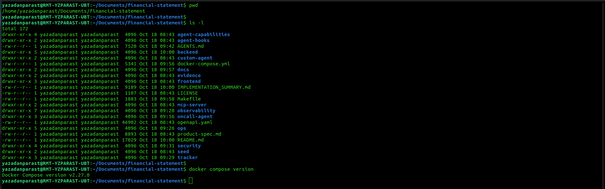

**Step 1 is complete.** Continue to Step 2 to test the app-only Compose stack. The public
GitHub repository is a later owner task (Step 4).

## Step 2 — Verify the app-only Compose stack

From the repository root:

```bash
cd "$HOME/Documents/financial-statement"  # the project root shown in Step 1
if [ ! -f .env ]; then
  cp .env.example .env
  python3 - <<'PYSECRET'
from pathlib import Path
import secrets
p = Path(".env")
t = p.read_text().replace("JWT_SECRET=change-me", f"JWT_SECRET={secrets.token_urlsafe(48)}")
p.write_text(t)
print("Generated a local JWT secret; value not displayed.")
PYSECRET
fi
docker compose config --quiet              # should return with no errors
docker compose up --build                  # leave this terminal running
```

Do not share or commit `.env`. In another terminal:

```bash
curl -fsS http://localhost:8000/healthz
curl -I http://localhost:3000
```

Expected for this sub-step: `docker compose ps` shows `db` and `backend` healthy and
`frontend` up; health JSON is `{"status":"ok"}`; the frontend returns HTTP 200 and displays
the sign-in screen. In this run the first build hit a Buildx permission error, then the
owner's `sudo docker compose up -d` retry succeeded. The error is documented in
`ops/troubleshooting/001-buildkit-permission-denied.md`; its failed screenshot is not kept
in evidence. Successful frames:

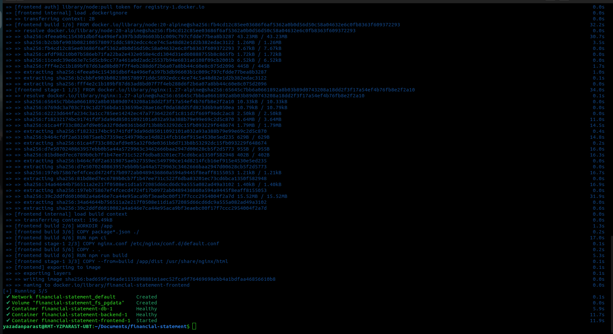

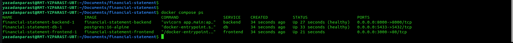

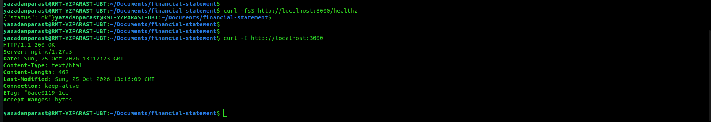

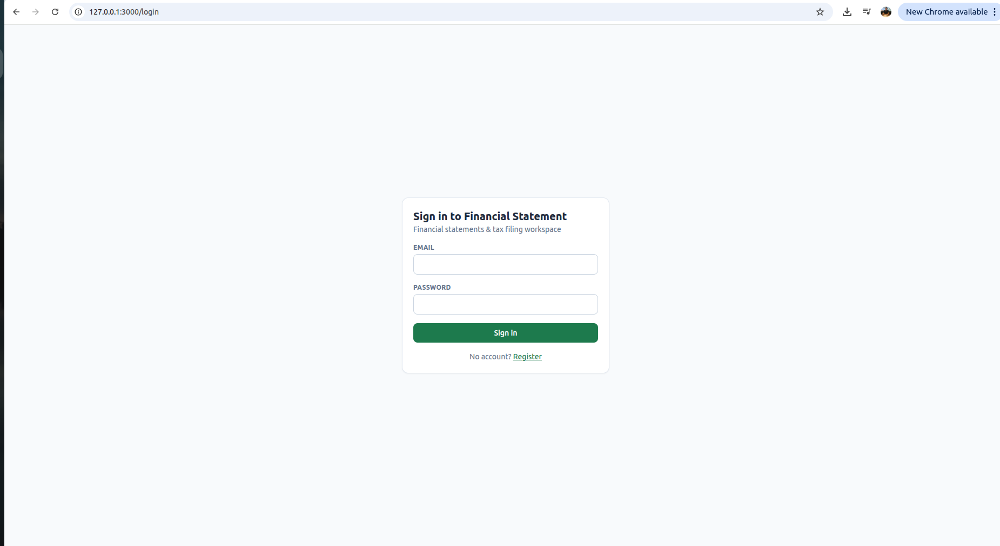

**Step 2 is complete; leave the services running.** The full HTTP smoke test is Step 3.
## Step 3 — Run the full HTTP smoke test

Keep the app-only Compose stack running. In a terminal at the project root:

```bash
cd "$HOME/Documents/financial-statement"
bash ops/smoke.sh http://localhost:8000
```

**Verified 2026-10-25:** the successful run returned **28 passed, 0 failed**. It covered
health/version, preparer/reviewer logins, prior-year statements, company/filing setup, TB
upload, statement generation, R001/R007, cash flow and ratios, self-critique notes, ReWOO
memo, ReAct chat, submit/review/accept, PDF/XLSX export, checklist, and Prometheus metrics.

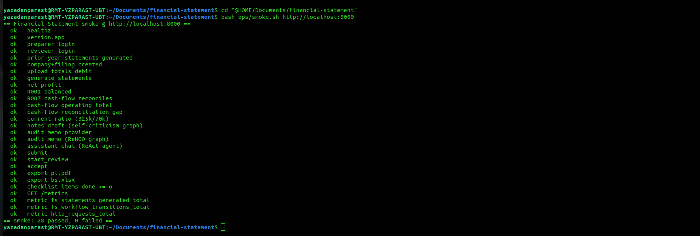

Step 3 is complete. Keep the stack running for subsequent local verification.

## Step 4 — Publish the project source to GitHub (verified)

Public repository: `https://github.com/yazdanparasthesam/financial-statement`.
The project source is on `main`, and the original GitHub starter commit is preserved in history.

The owner initialized an isolated repository at `/home/yazdanparasthesam/Documents/financial-statement`,
committed the project as `23ce9fb`, and merged the public starter commit `a050edf` using
`--allow-unrelated-histories`. Add/add conflicts in `.gitignore`, `LICENSE`, and `README.md`
were resolved conservatively: the generic Python ignore template was combined with project
secret/database protections; the complete project README was retained; and the MIT license
attribution uses the owner-confirmed handle `yazdanparasthesam`.

Merge commit `1b72378` has two parents (`23ce9fb` and `a050edf`). The normal push succeeded:
`a050edf..1b72378 main -> main`; `main` tracks `origin/main`, and `git status -sb` reported
`## main...origin/main` (clean). No force-push was used.

Success evidence:

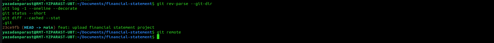

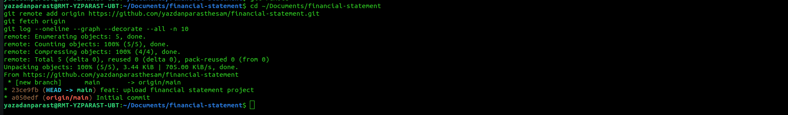

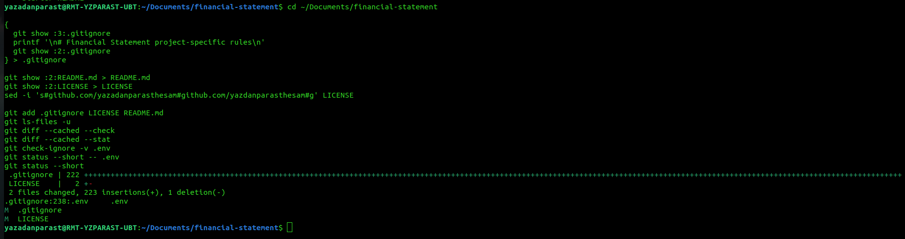

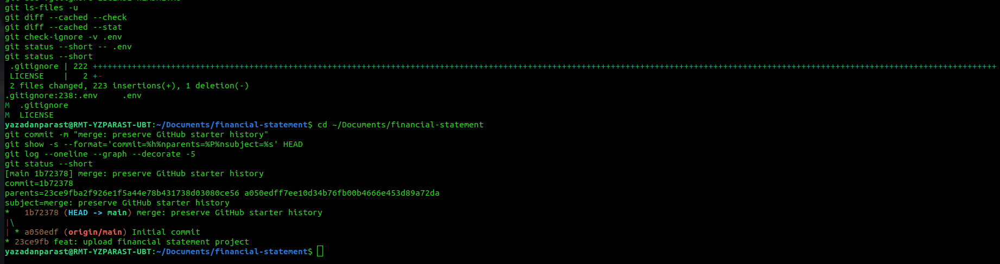

**Important repository safety note:** a separate parent-repository commit `d6fb15b` was
accidentally created under `$HOME`; it was not pushed. Never push from `$HOME`. Continue Git
commands only from the nested project root. Do not reset/revert/clean the parent repository
until its own remote and history are checked.

The owner asked to defer overlaying the updated evidence archive until the end. At final
packaging, overlay the rebuilt ZIP (excluding `.env`) into the current local folder and push
the documentation/evidence update as a follow-up commit.

## Step 5 — Public tracker status (import completed)

The issue definitions in `tracker/issues/` were imported into the public GitHub tracker. The
current public Issues page shows 14 issues: **#1–#8 and #14 closed; #9–#13 open**. Issue #8 was
closed after the verified green CI run. Public issues #10–#12 remain open even though their local
issue files and runbook contain completion evidence; reconcile those statuses and attach the
relevant evidence links before running `tracker/import.sh --sync-state` again. The initial public
issues screenshot below was taken before #8 closed, so it correctly shows the earlier six-open
state and is historical evidence, not the current count.

Public tracker: <https://github.com/yazdanparasthesam/financial-statement/issues>.
Each issue includes acceptance criteria and an agent evidence log; issue #8 also links the CI run
and commit that closed it. Continue referencing issue numbers in future commits/PRs.

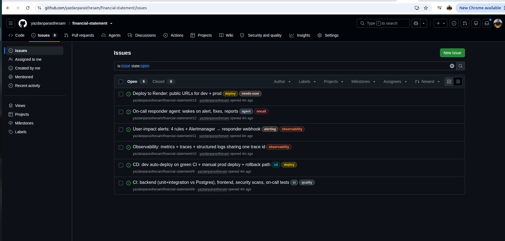

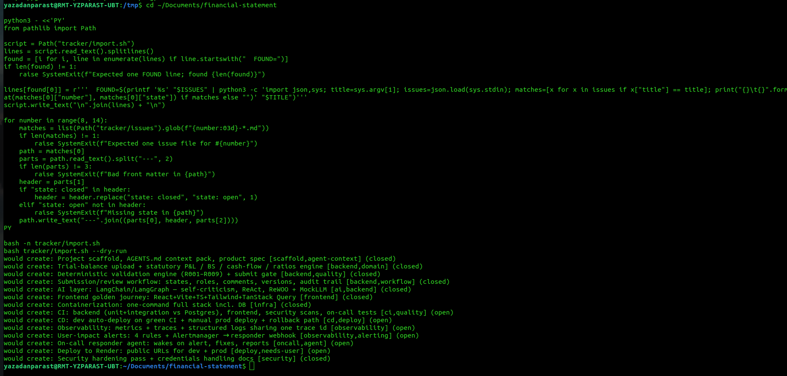

### Hosted CI — verified green

After updating the Trivy action to a verified SHA, CI run #3 on commit `6b643c1` passed all four jobs: backend, frontend, oncall-agent, and security. The security summary reported “No leaks detected”; both SARIF and security scan artifacts were produced. The screenshots are successful evidence. Node 20 action-runtime deprecation notices are non-blocking and remain a maintenance note.

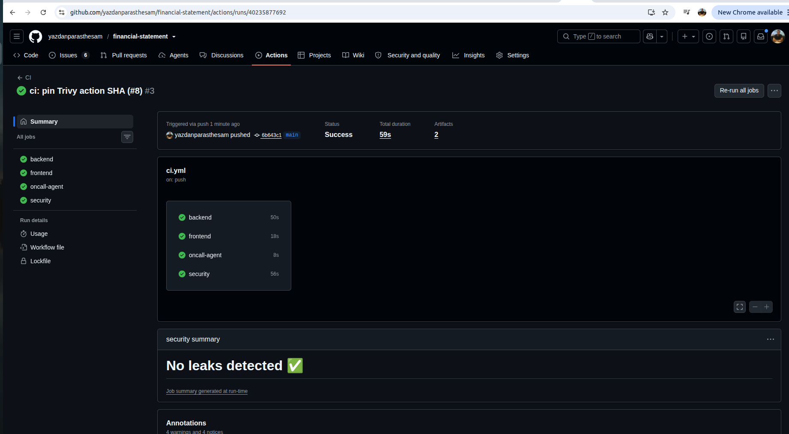

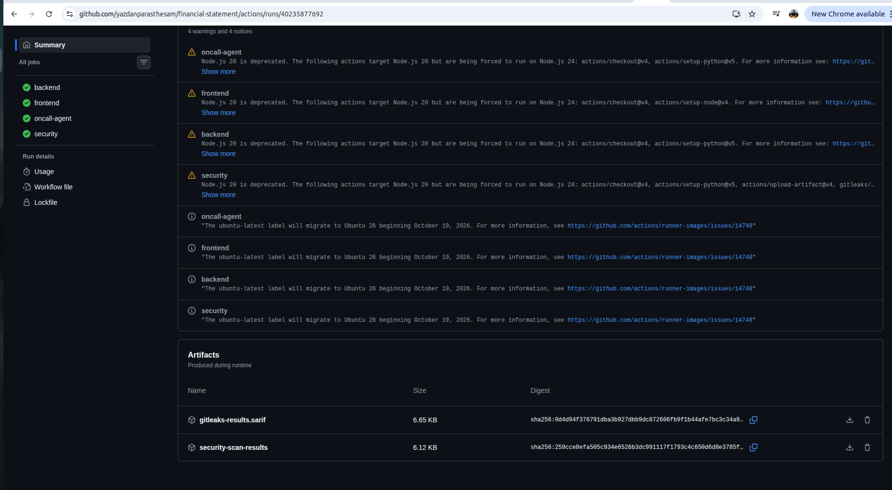

Issue #8 is now closed publicly with the CI run URL and commit recorded in its evidence log.

## Step 6 — Verify observability, then run the real alert drill

The owner started the observability profile with telemetry enabled:

```bash
sudo env OTEL_ENABLED=true docker compose --profile obs up --build -d
sudo docker compose --profile obs ps
```

The app and telemetry services started; DB/backend and responder healthchecks passed. The
Prometheus scrape target `financial-statement-backend` is **1/1 UP**, and Alertmanager shows
no alert groups before the drill. Responder `/healthz`, Prometheus `/-/healthy`, and
Alertmanager `/-/healthy` all returned success.

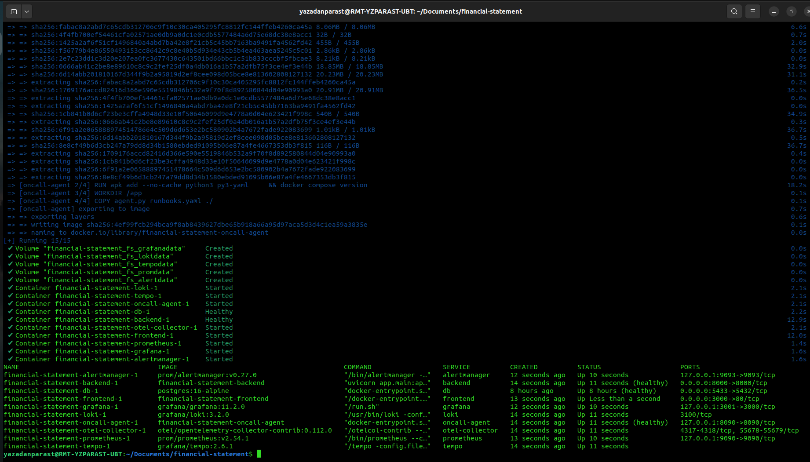

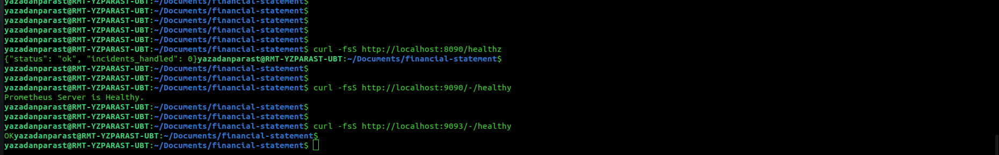

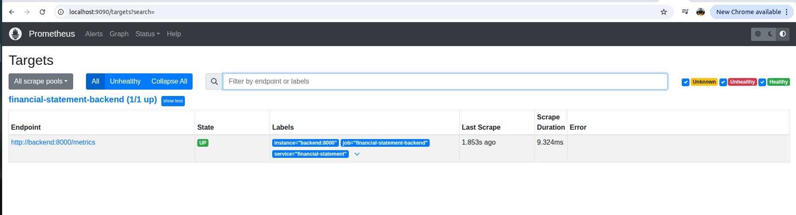

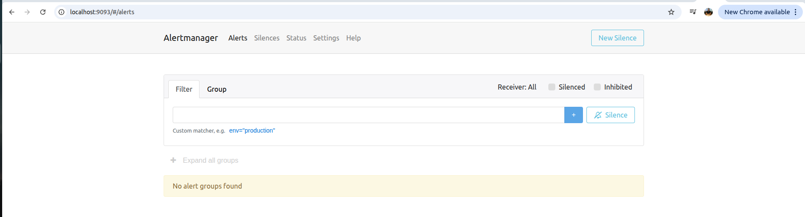

To generate telemetry, the owner reran the full HTTP smoke after enabling OTel:

```bash
bash ops/smoke.sh http://localhost:8000
```

It passed **28/28**, including statement/workflow/HTTP metrics. Successful capture:

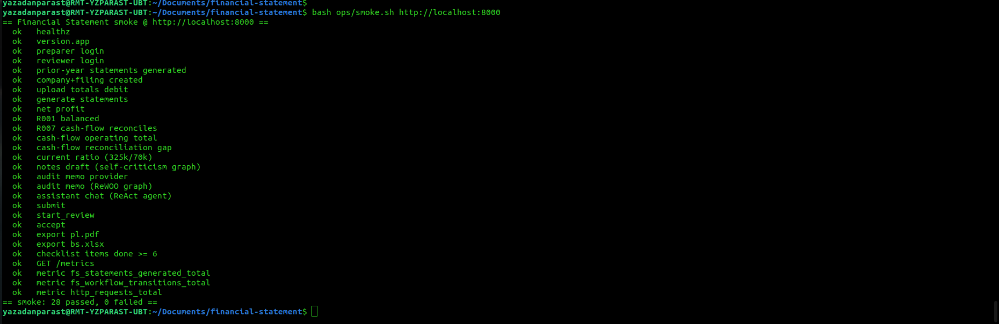

After the initial scrape baseline, the owner reran the smoke and waited 25 seconds. Prometheus then reported statement-counter increase `5.1085` and HTTP-request increase `26.5663`; the golden-journey dashboard populated request rate, p95 latency, journey-step timing, statements (5), failed validations (1), submits (1), accepts (1), and AI calls. The 5xx panel has “No data,” expected because no 5xx responses occurred. The earlier zero-valued view is documented in `ops/troubleshooting/007-grafana-panels-zero.md` and is not retained as evidence.

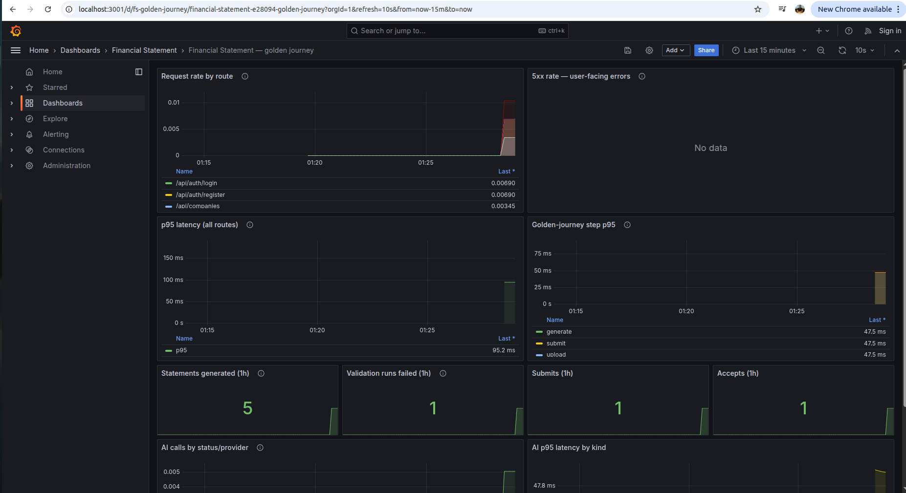

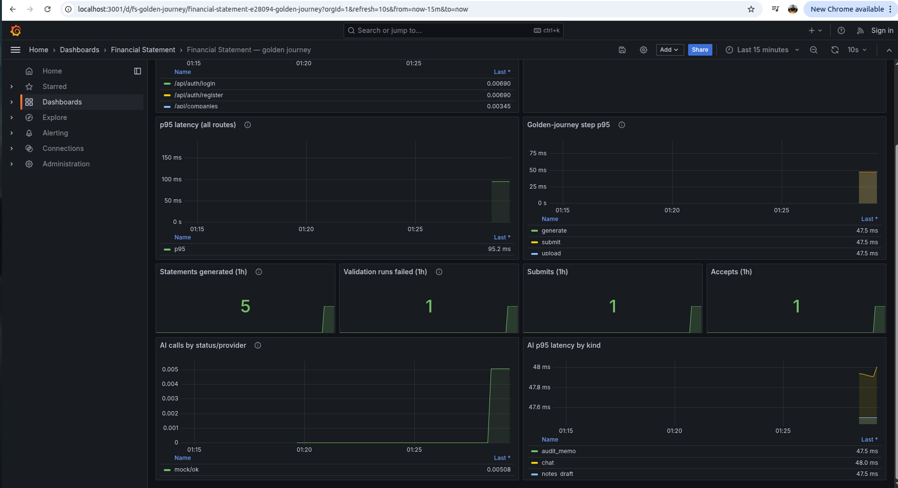

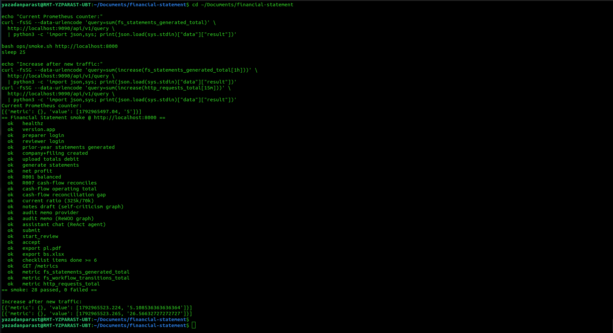

Loki verification succeeded in Grafana Explore with `{service_name="financial-statement-backend"}` over the last 15 minutes: 142 JSON request logs were returned, and request entries include non-empty `trace_id` values. Success captures:

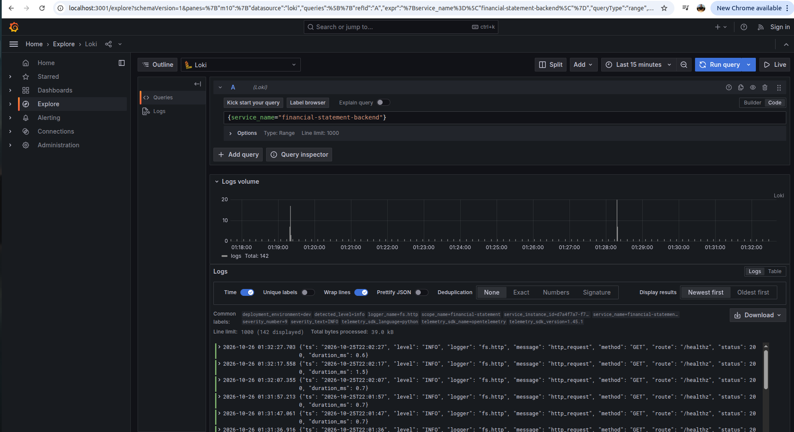

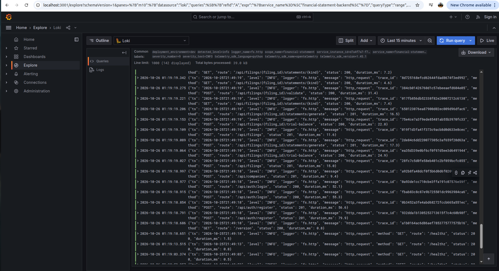

Tempo correlation succeeded: expanding a Loki request log exposed its `TraceID` link. Clicking it opened a Tempo trace with the same trace ID and multiple spans. Success evidence:

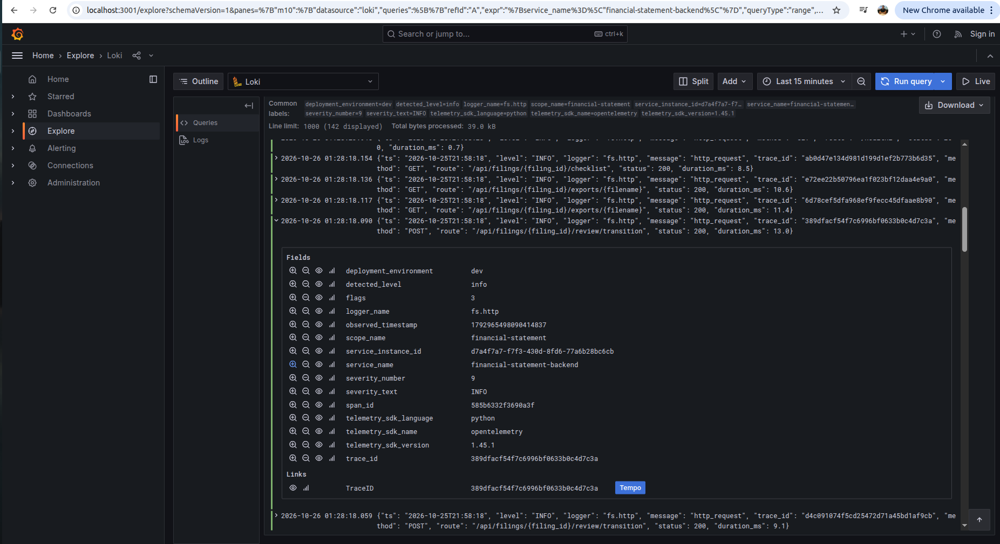

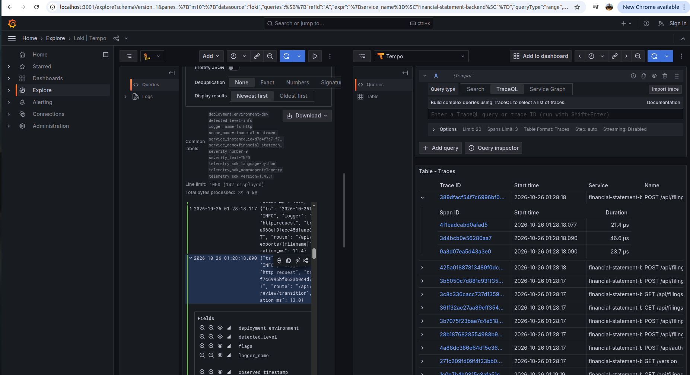

Observability metrics, logs, and traces are now verified. The next step is the real BackendDown alert drill; do not stop the profile before it completes.

After successful dashboard/log/trace checks, run the **real alert trigger** (it intentionally
stops the backend; the in-Compose responder restarts and verifies recovery):

```bash
sudo ./ops/alert-drill.sh
```

Expected: Prometheus `BackendDown` fires, Alertmanager posts to the internal responder,
`docker compose restart backend` runs, `/healthz` recovers, and a Markdown report appears in
`ops/incidents/`. Verify the report status is `remediated`; confirm Prometheus target returns
UP and Grafana recovers. The full drill reported `DRILL PASSED`, wrote incident report `ops/incidents/20261025-221233-BackendDown-2e62e391.md` with status `remediated`; a later Alertmanager resolved notification produced `ops/incidents/20261025-221257-BackendDown-2e62e391.md`, and `/healthz` recovered after two attempts. The first follow-up view was stale/unhealthy; after waiting and refreshing, Prometheus showed the backend target `1/1 UP` and Alertmanager showed no alert groups. This confirms the post-recovery state; do not rerun the drill. The mismatch and resolution are recorded in `ops/troubleshooting/008-alert-drill-post-recovery-check.md`.

Successful post-recovery captures:

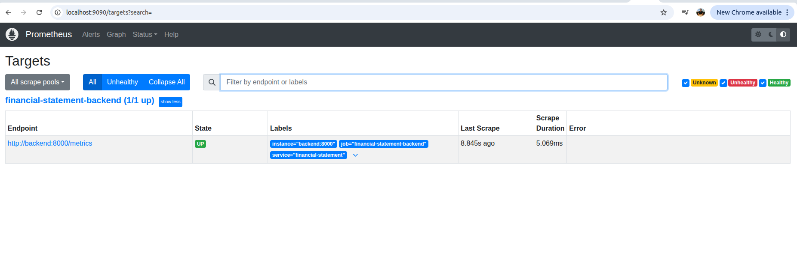

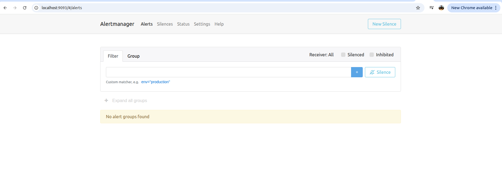

Optional no-outage webhook drill:
`sudo ./ops/alert-drill.sh --simulate`.

When done, shut down the profile without deleting data:

```bash
sudo docker compose --profile obs down
```

## Step 7 — Configure dev/prod deployment and CI/CD

### Neon Postgres integration (verified locally)

The user linked the existing Neon `production` branch, confirmed the plan had no changes (Postgres only), and ran `neon deploy`. The command confirmed the branch policy matches and pulled `DATABASE_URL`, `DATABASE_URL_UNPOOLED`, and `NEON_BRANCH` into the ignored local `.env`; values were not captured. Successful output is embedded below.

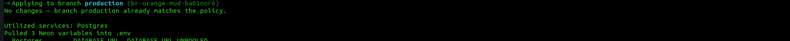

The CLI-generated `neon.ts`, root `package.json`, and lockfile are now incorporated. The branch policy disables Neon Auth (existing app JWT auth is preserved) and applies a seven-day TTL only to newly created non-default branches. Workspace code now reads repository-root `.env` / `.env.local` as well as the legacy `backend/.env`, and maps generic Postgres URLs to SQLAlchemy's existing psycopg 3 driver. Verification in the workspace: `ruff check app tests scripts` passed; the complete backend pytest suite exited 0; root `npm ci && npm run build` passed (TypeScript check, Vite production bundle, 102 modules); root `npm test` passed (27 frontend tests). `npm audit` reported 11 dependency advisories (8 moderate, 1 high, 2 critical); available high/critical fixes require major toolchain upgrades, so no `--force` upgrade was applied. Added `ops/neon-e2e-smoke.py`, which exercises FastAPI startup, database-backed register/login/me, and cleanup while reading the local branch URL without printing it. The user ran it against the checked-out temporary `neon-smoke` branch: `/healthz=200`, registration `201`, login `200`, `/me=200`, and the temporary user was cleaned up. This is the live FastAPI-to-Neon verification; the earlier workspace SQLite check was helper validation only.

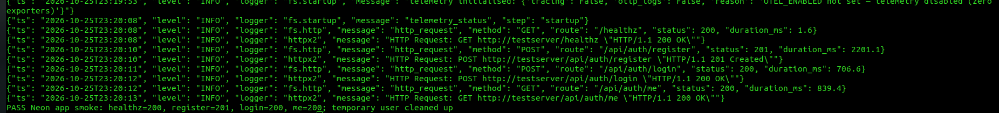

### In-app UI evidence (synthetic trial-balance data)

The following owner-provided UI captures are cropped to remove the signed-in email. They show a balanced 20-account trial balance, generated P&L and balance sheet, the clean 8/8 validation result, and a submitted filing with its mock audit memo. In this one-year demo, R006 (year-over-year) and R007 (cash-flow reconciliation) correctly report that they were skipped because no prior-year statements were on file; the figures remain deterministic. The live Neon connection itself is proven separately by the API smoke above.

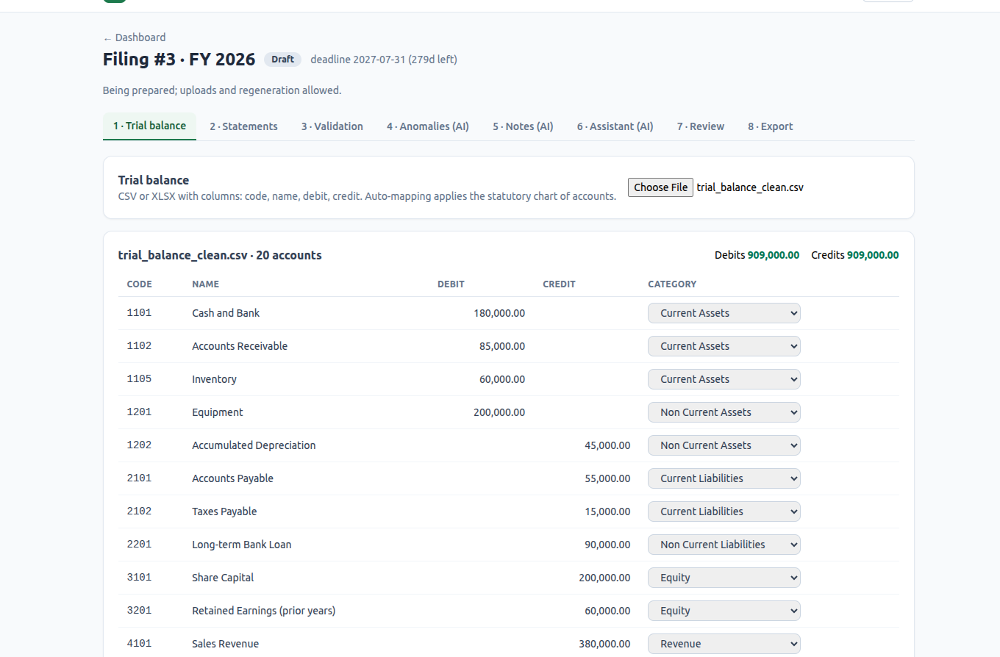

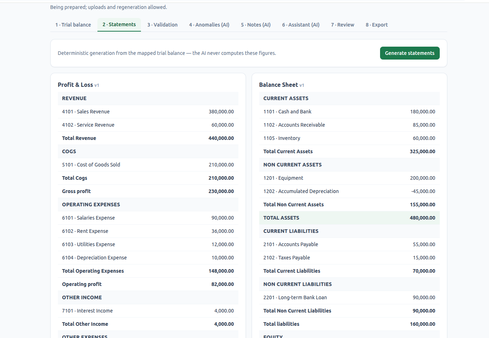

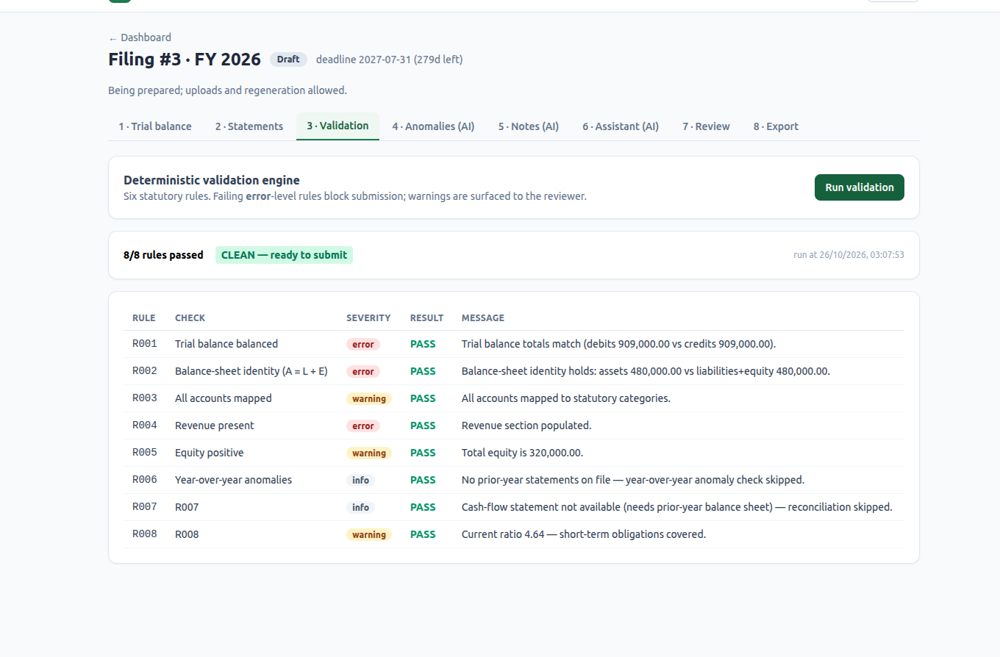

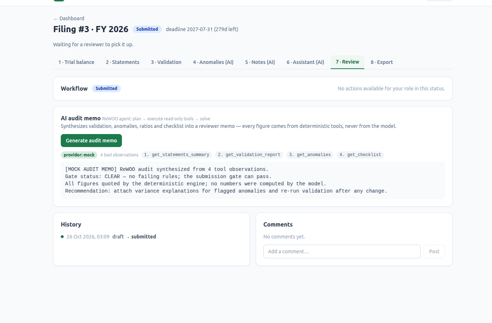

### Neon Console evidence (temporary `neon-smoke` branch)

Owner-provided Neon Console captures show `neon-smoke` as a child of `production`, the application tables/schema present on that branch, and database monitoring activity after the API smoke. The data grid is empty because the smoke helper removes its temporary user and audit row; the schema remains. Browser URLs/account header were cropped, and no connection details are included.

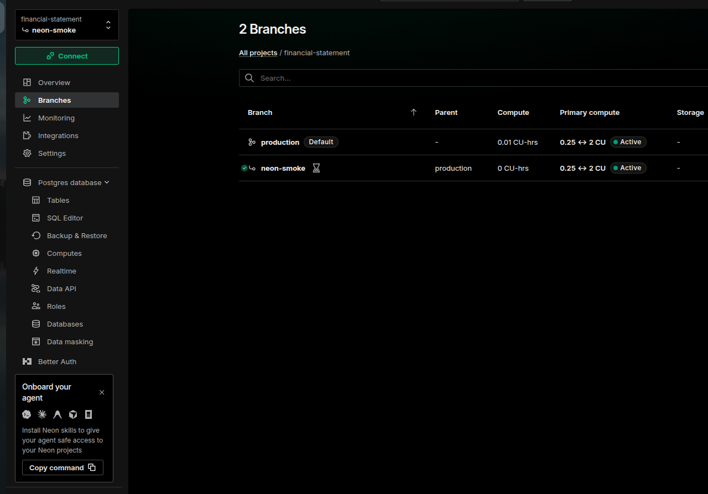

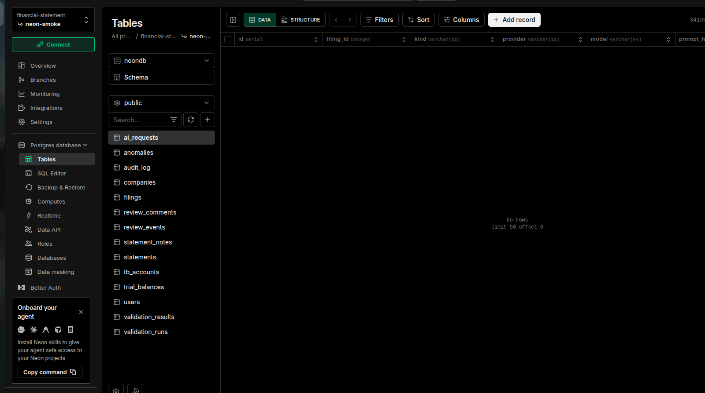

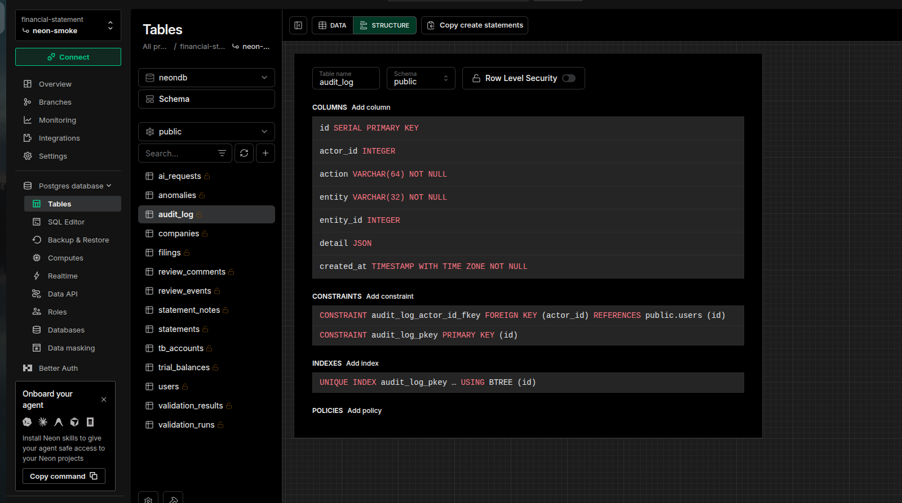

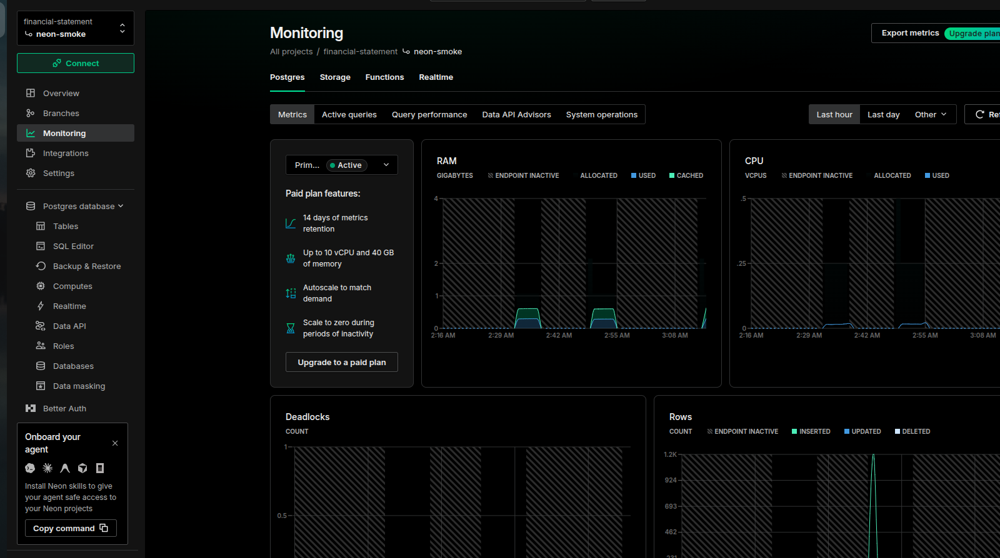

The CLI-generated `neon.ts` and root npm manifest/lockfile have been copied into the workspace and validated by the root build. The workspace model timestamp helper now uses `datetime.timezone.utc` for Python 3.10 compatibility.

### Provider setup access (not deployment proof)

These provider-access captures are historical setup evidence. At that time the FastAPI Cloud dashboard displayed “Create your first app”; the Vercel Hobby workspace was accessible. Since then, `fs-dev-api` was created, its GitHub source was disconnected, and the app was deployed through the CI-gated workflow; see evidence 40 and 56. The Render attempt stopped at the account-level Add Card prompt; no payment details were entered and no Render service was created. See [`ops/troubleshooting/011-render-free-service-card-gate.md`](../ops/troubleshooting/011-render-free-service-card-gate.md) for the prose-only failure record. No raw screenshot containing database credentials or JWT values is retained.

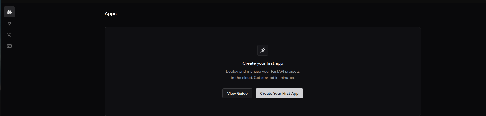

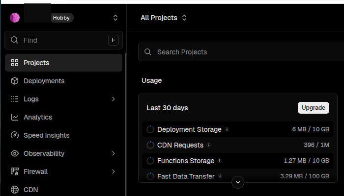

### Initial FastAPI Cloud dev API setup (historical pre-deployment state)

The status text in this setup sequence records what the screenshots showed at capture time. It is historical; the API is now Live and its CI-gated deploy evidence is indexed above.

The Create New App screen offered **GitHub Repo** or **Empty**. The user installed the FastAPI Cloud GitHub App; the repository picker then displayed the public `financial-statement` repository. The final pre-create settings used app name `fs-dev-api` and application directory `backend`.

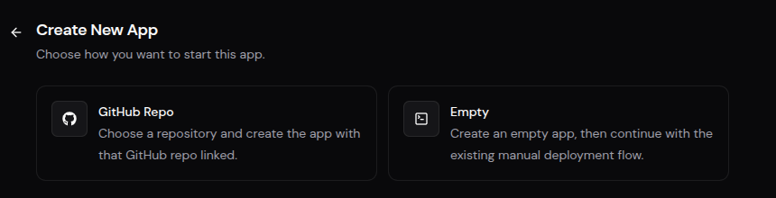

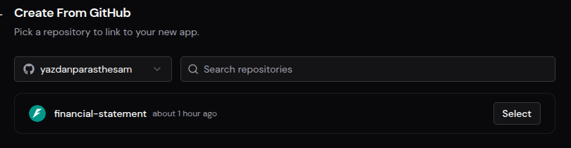

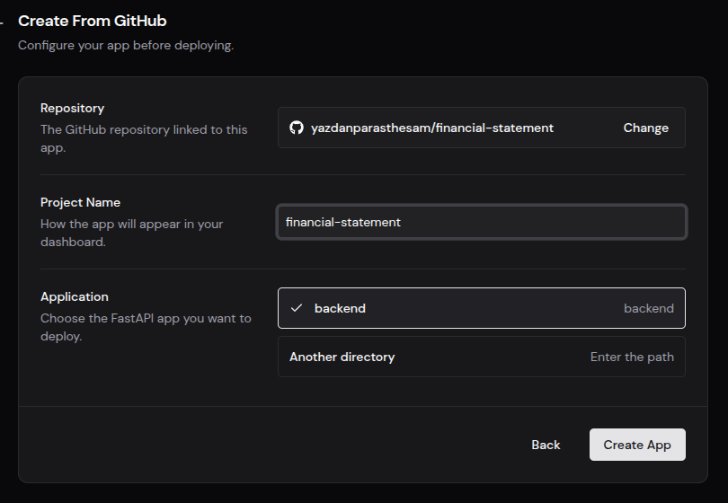

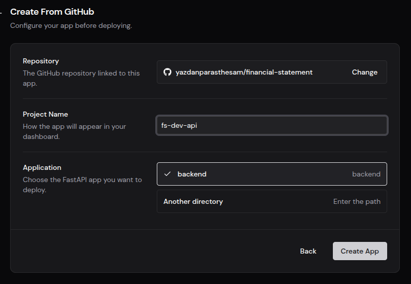

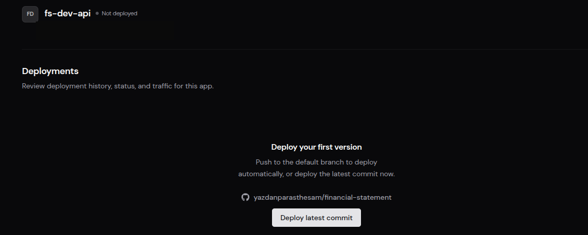

At this point in setup, the newly created `fs-dev-api` app showed **Not deployed**. The screen offered “Deploy latest commit” and said pushes to the default branch could deploy automatically. The linked GitHub repository was subsequently disconnected before any gated deployment. Do **not** click **Deploy latest commit** or reconnect native source deployment. The first GitHub picker screen showed no installation; the user resolved that setup issue by installing the GitHub App. That failed-state screenshot is not retained; the outcome is recorded here in prose only. The deployment-gate decision and official references are in [`ops/troubleshooting/012-fastapi-cloud-github-auto-deploy-gate.md`](../ops/troubleshooting/012-fastapi-cloud-github-auto-deploy-gate.md).

The app code selection is correct: `backend/requirements.txt` exists, `backend/app/main.py` exports the FastAPI instance as `app`, and `backend/Dockerfile` starts `uvicorn app.main:app`; `backend` is the right application directory.

Before disconnection, Settings confirmed `backend` as the root directory and showed the connected GitHub repository. The app was not deployed. The **Disconnect** control disconnects the app's source integration, not the GitHub repository or app itself.

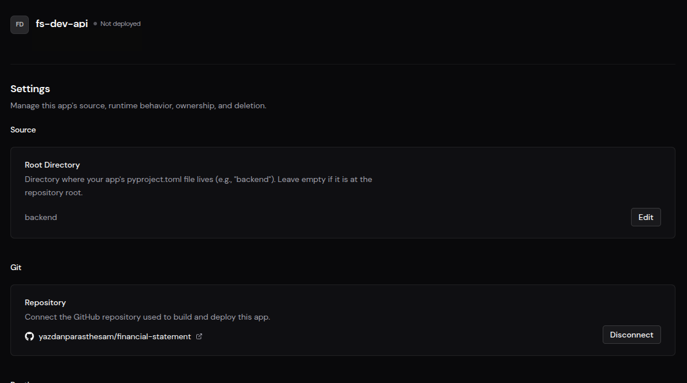

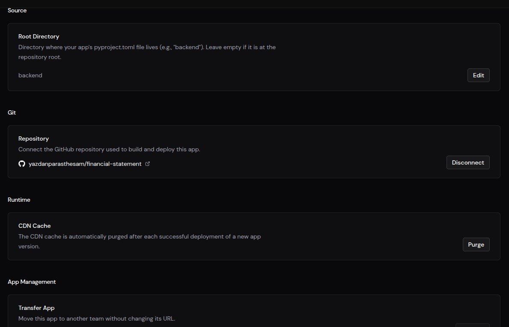

The user confirmed the disconnect dialog. Immediately after disconnection, settings showed the repository **Not Connected** while retaining root directory `backend`; at that historical point the app was still **Not deployed**. This prevents native GitHub-triggered deployments so the controlled CI gate remains authoritative.

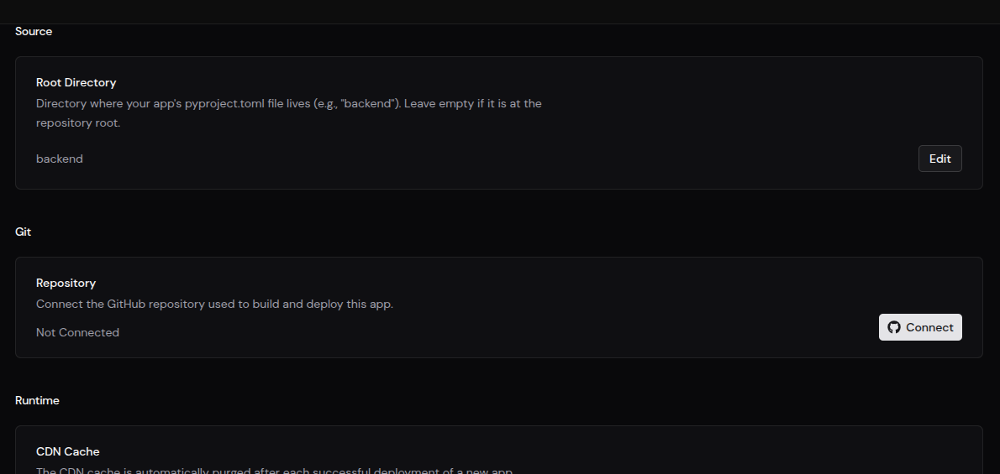

The Environment Variables page currently shows **No environment variables yet**; no values have been set. The app is still not deployed.

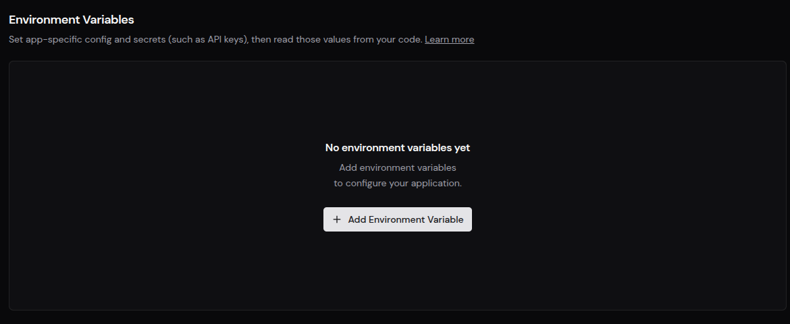

The user opened the blank key/value form. No values have been entered or saved. It offers a Secret toggle and **Save and Redeploy**; do not save/redeploy until fresh credentials and intended settings are ready. Do not use **Import .env**, because the local file may contain stale/exposed credentials and unrelated settings.

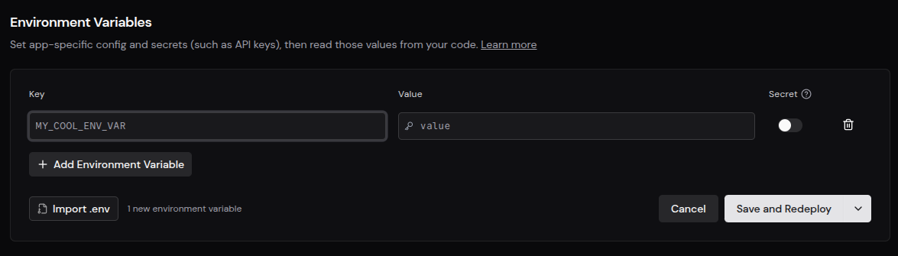

The previously exposed dev Neon credential has now been rotated according to the user's report. Neon documents branch-scoped role password resets and invalidation of the prior password ([reset a role password](https://neon.com/docs/manage/roles)); the first successful application connection will verify the new value. Use the pooled `dev` connection for `DATABASE_URL` (`-pooler` host; pooling enabled; [Neon connection strings](https://neon.com/docs/connect/connect-from-any-app)) and mark the value as Secret in FastAPI Cloud. Generate a new high-entropy `JWT_SECRET` locally and mark it Secret too. Keep `AI_PROVIDER=mock` (the code default); set exact `CORS_ORIGINS` after the Vercel dev URL exists. Never include credential values in evidence.

The Neon Console Roles page showed the `dev` branch role `neondb_owner`, which owns database `neondb`; no passwords or connection strings were shown. The user subsequently reported completing the password reset.


The user reports completing the reset for the `dev` branch role. The post-reset Roles screen is shown below without any credential; it does not itself prove the new password works. The first successful connection from the app will verify it.


The user copied the pooled Neon connection string for branch `dev`, database `neondb`, role `neondb_owner` after the password reset. The string has not been shared in chat or captured; the successful CI-gated API lifecycle smoke subsequently verified the dev database connection. Neon recommends pooled connection strings for serverless app traffic ([connection strings](https://neon.com/docs/connect/connect-from-any-app)). If the earlier exposed URL might have used the production branch, rotate that branch’s password separately before production setup.

**Completed setup — dev secrets saved without an immediate redeploy:**

1. Added the private pooled Neon `dev` connection as secret `DATABASE_URL`.
2. Generated a fresh high-entropy `JWT_SECRET` locally and saved it as a secret; the previously exposed value was not reused.
3. Chose **Save Only**, not **Save and Redeploy**, so the values applied on the next CI-gated API deployment. FastAPI Cloud documents this behavior in its [environment-variable guidance](https://fastapicloud.com/docs/builds-and-deployments/environment-variables/).
4. Kept `AI_PROVIDER` at its deterministic `mock` default; later set `CORS_ORIGINS` to the exact Vercel dev origin. Secret values were never included in evidence.

At the pre-deployment stage, the first screenshot showed only key names; the follow-up confirmed both `DATABASE_URL` and `JWT_SECRET` were saved as masked secrets, and the user confirmed **Save Only**. The app had not yet been deployed at that point.


The user created an active FastAPI Cloud deploy token; the dashboard shows it has never been used and expires 2027-01-25. Its displayed name is truncated in the screenshot and its value is not shown. The app remains not deployed.


The user added repository Actions secrets `FASTAPI_CLOUD_APP_ID` and `FASTAPI_CLOUD_TOKEN`; the values are hidden and were not shared. The app is still not deployed.


The provider-adapted `.github/workflows/deploy.yml` was first committed as `a520622` (see workflow commit evidence below). Deploy #5 identified an app-directory mismatch; commit `0f1854c` corrected the CLI working directory. Deploy #6 then exposed the missing `fastapi[standard]` runtime extra; commit `009f887` fixed `backend/requirements.txt`. On `009f887`, CI run #7 and gated Deploy run #7 passed. The FastAPI Cloud dashboard now shows `fs-dev-api` **Live** with the latest deployment **Ready** at `https://fs-dev-api.fastapicloud.dev` in `us-east-1`. The green Deploy run includes the `/healthz` check and `ops/smoke.sh`; both passed. The previous failed attempts are recorded in prose only in troubleshooting records [012](../ops/troubleshooting/012-fastapi-cloud-github-auto-deploy-gate.md) and [013](../ops/troubleshooting/013-fastapi-cloud-healthz-404.md).


After the Vercel project domain was assigned, `CORS_ORIGINS` was saved as the exact origin `https://fs-dev-web.vercel.app` using **Save Only**. The API remains live on its previous deployment until the next CI-gated deploy applies this configuration. Database and JWT values remain masked.


Use separate Neon branches and distinct JWT secrets for dev and production. The `dev` branch exists with `production` as its parent; `neon-smoke` is temporary and must not be used for a long-lived deployment. Dev API deployment and smoke verification are complete.

Vercel Hobby project `fs-dev-web` was created empty through the CLI and the local `frontend/` folder is now linked to it under team `hesam2`. The project remains Git-unconnected and undeployed, preserving the CI gate; assigned domain is `fs-dev-web.vercel.app`. During linking, Vercel CLI created a local `.env.local` containing `VERCEL_OIDC_TOKEN` and added it to `.gitignore`; never share or commit that file. The initial npm registry DNS errors and successful link are documented in troubleshooting record [014](../ops/troubleshooting/014-vercel-cli-npm-registry-dns.md).


The project settings now specify root `frontend`, install `npm ci`, build `npm run build`, and output `dist`; the preset remains `Other`, but the explicit Vite build overrides are saved. The Basic Hobby build machine remains selected; no Pro-only build or release option was enabled. `VITE_API_URL` has been added for Production (the target used by the CI workflow's planned `--prod` deployment to this dev project); the screenshot masks its value, so confirm it equals `https://fs-dev-api.fastapicloud.dev` before deployment. Preview-target variable is not required for the planned Production-target workflow.


The local project metadata was inspected to obtain Vercel's organization/project identifiers; the public evidence crop retains only the project name. The Vercel token form was set to project scope `fs-dev-web` with a 30-day expiry (2026-11-26); the token value is not retained in evidence. The owner added GitHub repository secrets `VERCEL_ORG_ID`, `VERCEL_PROJECT_ID`, and `VERCEL_TOKEN`; the values remain hidden. Keep Vercel Git-unconnected. The committed `.github/workflows/deploy-vercel.yml` deploys the exact SHA only after the CI-gated API Deploy workflow succeeds. `frontend/vercel.json` supplies the Vite SPA fallback for direct routes such as `/login`, and the workflow smoke check exercises both `/` and `/login`.

The latest sequence is green: CI #10 for `10f7387`, API Deploy #10, and Deploy Vercel Web #3. Independent public HTTP checks returned 200 for the frontend `/`, `/login`, and API `/healthz`. The owner then completed the live browser workflow through registration/login, company and FY2026 filing creation, a 20-account balanced trial-balance upload, statement generation, 8/8 validation, mock notes, and an audit memo. This successful API-backed flow functionally confirms the dev frontend/API connection without revealing `VITE_API_URL`. The filing remains **Draft**. The Export checklist shows notes not finalized and submission/reviewer acceptance unchecked. The following cropped status snapshot is progress-only, not completion evidence. All stored evidence copies redact the account email and any entered identifiers.


The exact dev CORS origin was saved and applied by the gated API deployment. Production resources and GitHub `production` reviewer protection remain pending. The next dev-demo action is to click **Submit for review** on the synthetic filing and capture its resulting status; do not use real financial data.
## Step 8 — Final evidence and course submission

1. In `evidence/README.md`, tick each evidence row only after the screenshot exists.
2. Embed evidence screenshots in the runbook below the matching step (success images only).
3. Run `make test`, `make lint`, `cd frontend && npm test && npm run build`, plus the live
   smoke test against the deployed dev URL.
4. Confirm the FAQ field uses the accepted issue URL:
   `https://github.com/DataTalksClub/faq/issues/440` (optional contribution field).
5. On the course platform, evaluate **three other participants' projects**. This is mandatory
   for passing, regardless of your project score.
6. Submit the public repo URL, deployed frontend/backend URLs, tracker URL, evidence index,
   and FAQ URL (optional field). Keep screenshots of the successful submission/review state.
## Evidence embedding template

After each successful step, copy the screenshot into `evidence/` and add it here. Do not put
failed-state screenshots in this directory; document failures as dated prose in the relevant
issue/runbook instead.

<!-- Evidence images are embedded here as the owner completes the steps. -->
